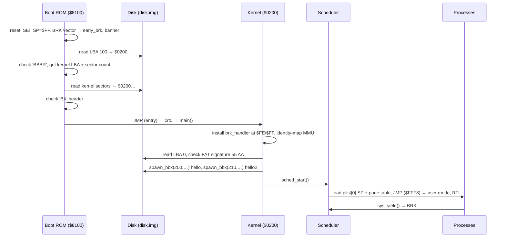

# Architecture

## The pieces

```
              host processes                              files
 ┌──────────────────────────────────────────┐
 │ vvp build/sim.vvp  (or sim_dbg.vvp)      │
 │  ┌──────── tb.v: the machine ─────────┐  │   build/bootrom.hex  (ROM contents)
 │  │ cpu (Arlet 65C02)                  │  │   build/disk.img     (the disk)
 │  │  │ AB/DI/DO/WE   ┌── mmu6502 ──┐   │  │
 │  │  ├──────────────►│ translate   │──►RAM 32K
 │  │  │               │ fault → NMI │   │  │
 │  │  ├──► ROM 32K    └─────────────┘   │  │
 │  │  └──► I/O: ACIA  GPU  disk  MMU-regs│  │
 │  └──────────┬────────┬──────────────────┘  │
 │   stdout ◄──┘        │   (debug build: bbdbg.vpi ncurses debugger)
 └──────────────────────┼─────────────────────┘
                        │ /tmp/bb6502_gpu  (bytes → screen)
                        │ /tmp/bb6502_in   (keys → ACIA RX)
                 ┌──────┴───────┐
                 │ build/gpu    │  SDL window, 80×25 text
                 └──────────────┘
```

- **`rtl/tb.v`** is the whole computer: it instantiates the CPU and the MMU, holds RAM and ROM as Verilog arrays, and models every I/O device. Its name comes from "testbench", but it plays the role of the motherboard.
- **`rtl/mmu6502.v`** is the memory management unit. See [hardware.md](hardware.md#mmu).
- **`rtl/verilog-65C02-microcode/`** is Arlet Ottens' 65C02 core, as a git submodule pointing at the project's fork.
- **`tools/gpu.c`** runs as a separate process. It draws whatever the CPU writes to the GPU port and sends key presses back.
- **`rtl/dbg/`** holds the debugger, a VPI module loaded into `vvp` by `make run-dbg`. See [debugger.md](debugger.md).

## Boot sequence



Everything before `sched_start` runs in **kernel mode**, where the MMU passes addresses through unchanged. Processes run in **user mode**, where each one sees its own 32 KB through its page table.

## Control transfers between kernel and user

| From → to | How |
|---|---|
| User → kernel | `BRK` + a syscall-number byte. The CPU fetches the IRQ/BRK vector at `$FFFE`, which pulls `VPB` low, and the MMU switches to kernel mode. The vector points at `brk_trampoline` (`JMP ($00FE)`), which jumps to the kernel's `brk_handler`. |
| Kernel → user | `JMP ($FFF8)` → `ret_user_mode` in ROM: `STZ $80FA` (user mode), then `RTI`. The RTI pops the status and PC from the process's own stack page. |
| Fault | Any MMU violation forces kernel mode and raises NMI. The boot ROM's NMI handler is only `RTI` for now. |

## Repository layout

```
Makefile, common.mk     top-level build (see build-system.md)
rtl/
  tb.v                  the machine
  mmu6502.v             MMU
  rtl.mk                builds sim.vvp, sim_dbg.vvp, bbdbg.vpi, gpu
  dbg/                  debugger (VPI module)
  verilog-65C02-microcode/   CPU core (submodule)
sw/
  boot/                 boot ROM: boot.s, boot.cfg, devices.s
  kernel/               kernel: src/*.c, src/*.s, kernel.cfg, kernel.mk
  prog/                 user programs + syslib: src/, prog.cfg, prog.mk
tools/
  gpu.c                 SDL monitor
  mkbootrec.py          writes the boot record
  mkbbx.c, hxdmp.py     small helpers (not used by the build)
docs/                   these pages
build/                  everything generated (git-ignored)
```
